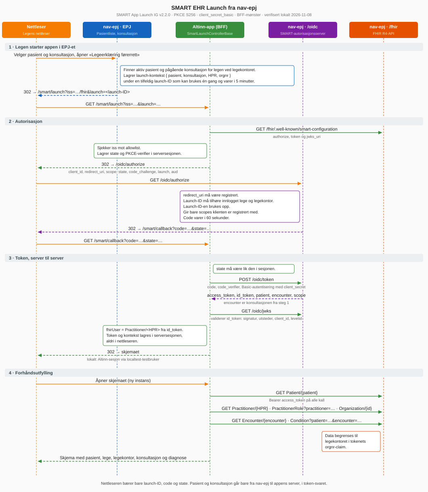

# Kjør appen lokalt med nav-epj

Denne guiden setter opp hele kjeden på din egen maskin: NAVs test-EPJ [`navikt/nav-epj`](https://github.com/navikt/nav-epj) starter appen med SMART EHR Launch, og appen forhåndsutfyller legeerklæringen fra nav-epj sitt FHIR-API.

Guiden erstatter [NAV-EPJ-TESTMILJO.md](NAV-EPJ-TESTMILJO.md), som beskriver nav-epj slik den var i august 2026.

## Slik henger det sammen

| Del | Adresse |
|---|---|
| Altinn localtest og appen | `http://local.altinn.cloud:8000/digdir/forer-legeerklaering` |
| nav-epj backend, med SMART og FHIR | `http://localhost:8080` |
| nav-epj frontend, selve EPJ-et | `http://localhost:5173` |

Legen åpner appen fra nav-epj. nav-epj sender nettleseren til appens `/smart/launch`. Appen henter token og FHIR-data på serversiden og åpner skjemaet ferdig utfylt.

[](smart-launch-nav-epj.svg)

Diagrammet viser hele flyten, og hvordan appen får vite hvilken pasient og konsultasjon den ble startet fra.

## Forutsetninger

- .NET 11 SDK. Appen bruker Altinn app v9.
- [studioctl](https://docs.altinn.studio/) (Altinn Studio CLI)
- Podman eller Docker, med Compose
- Java 25
- Node 22 eller nyere, med `corepack enable`

Ikke kjør repoets gamle `smart-mock` eller HAPI FHIR-serveren samtidig. HAPI bruker port 8080, som nav-epj trenger.

## 1. Start Altinn localtest

```bash
studioctl env hosts add   # én gang, legger til local.altinn.cloud i hosts-filen
studioctl env up
```

Localtest svarer på `http://local.altinn.cloud:8000`. Får du en annen port, må du endre porten i klientregistreringene i nav-epj sin `src/main/resources/application-local.yaml`.

## 2. Klon nav-epj

Bruk grenen `forer-legeerklaering` i vår fork av nav-epj:

```bash
git clone -b forer-legeerklaering https://github.com/nkylsta-bot/nav-epj.git
cd nav-epj
```

Grenen er NAVs nav-epj med tre tillegg:

- **Appen er registrert som SMART-klient**, både for launch fra EPJ-et og som systemklient for skrivingen tilbake. Registreringene står også i [`local-dev/nav-epj-testing/forer-legeerklaering-client.yaml`](../local-dev/nav-epj-testing/forer-legeerklaering-client.yaml).
- **`local.altinn.cloud` er tillatt over http.** nav-epj godtar ellers http bare for `localhost` og `127.0.0.1`, og localtest finner appen bare på `local.altinn.cloud`.
- **nav-epj tar imot PDF-er fra SMART-apper.** De vises under «Dokumenter fra apper» i journalen.

Frontenden henter også NAVs designsystem fra det åpne npm-registeret, så du trenger ikke et GitHub-token.

## 3. Start nav-epj

Start databasene, og deretter backend i ett terminalvindu:

```bash
docker compose up -d
./gradlew runLocal        # Windows: .\gradlew.bat runLocal
```

Backend er klar når `http://localhost:8080/fhir/.well-known/smart-configuration` svarer. Lokalt er du alltid logget inn som legen GRØNN VITS, HPR-nummer 565501872, ved Fjordvik Legekontor.

Start frontend i et annet terminalvindu:

```bash
cd frontend
yarn
yarn dev
```

All testdata slettes og legges inn på nytt hver gang backend starter.

## 4. Start appen

Gå tilbake til din klone av `forer-legeerklaering` i et nytt terminalvindu. Kommandoene under kjøres derfra, ikke fra nav-epj.

```bash
cd src/App
dotnet user-secrets set "SmartOnFhir:ClientSecret" "local-dev-secret"   # én gang
studioctl run
```

Hemmeligheten må være den samme som `clientSecret` i klientregistreringen fra steg 2.

**MSIS-meldingen** er en egen app i `src/msis-melding`. Den kan kjøre samtidig med legeerklæringen:

```bash
cd src/msis-melding
(cd App && dotnet user-secrets set "SmartOnFhir:ClientSecret" "local-dev-secret")   # én gang
studioctl run
```

Kjør `studioctl` fra `src/msis-melding`, ikke fra `src/msis-melding/App`. `studioctl` leter etter en mappe som heter `App`, og fra feil mappe finner den `src/App` i stedet.

Begge appene logger inn som testlegen Gul Barnestol. Når alle appene som kjører, har egne testdata, bruker localtest bare dem og ikke de innebygde testbrukerne.

## 5. Åpne appen fra nav-epj

1. Gå til `http://localhost:5173`.
2. Velg en pasient, for eksempel GLAD FJORD, og start en konsultasjon.
3. Åpne «Legeerklæring førerrett» fra applistene. Appen åpnes i en ny fane.

Skjemaet åpnes med pasient, lege, legekontor, konsultasjon og diagnose fylt ut.

**Uten frontend** kan du starte en launch direkte mot API-et. Det er nyttig hvis du ikke har et GitHub-token:

```bash
B=http://localhost:8080
P=$(curl -s $B/api/patient | jq -r '.[] | select(.givenName=="GLAD") | .id')
curl -s -X PUT $B/api/active-patient -H 'Content-Type: application/json' -d "{\"patientId\":\"$P\"}"
curl -s -X POST $B/api/patients/$P/consultations > /dev/null
curl -s -X POST $B/api/launch -H 'Content-Type: application/json' \
  -d "{\"appId\":\"forer-legeerklaering-poc\",\"patientId\":\"$P\"}" | jq -r .launchUrl
```

I PowerShell:

```powershell
$B = "http://localhost:8080"
$P = ((Invoke-RestMethod "$B/api/patient") | Where-Object givenName -eq "GLAD").id
Invoke-RestMethod -Method Put "$B/api/active-patient" -ContentType "application/json" -Body (@{ patientId = $P } | ConvertTo-Json) | Out-Null
Invoke-RestMethod -Method Post "$B/api/patients/$P/consultations" | Out-Null
(Invoke-RestMethod -Method Post "$B/api/launch" -ContentType "application/json" -Body (@{ appId = "forer-legeerklaering-poc"; patientId = $P } | ConvertTo-Json)).launchUrl
```

Åpne lenken som skrives ut, i nettleseren. Hver lenke virker én gang.

## Testscenarioer

| # | Scenario | Slik gjør du det | Forventet resultat |
|---|---|---|---|
| 1 | Forhåndsutfylling | Åpne appen for GLAD FJORD som i steg 5. | Fødselsnummer 30898110431, navn, fødselsdato og kjønn er fylt ut. Legen er GRØNN VITS med HPR-nummer 565501872, og legekontoret er Fjordvik Legekontor med organisasjonsnummer 311111116. Konsultasjonsdato og diagnose er også fylt ut. |
| 2 | Bytte pasient | Velg TRYGG FJORD i nav-epj, start en konsultasjon og åpne appen på nytt. | Et nytt skjema åpnes med TRYGG FJORD, fødselsnummer 02867910193. |
| 3 | Gjenbrukt launch | Åpne den samme launch-lenken en gang til, for eksempel fra nettleserhistorikken. | nav-epj avviser den, og appen viser «Authorization error: invalid_request». |
| 4 | Feil klienthemmelighet | Sett en annen verdi for `SmartOnFhir:ClientSecret`, start appen på nytt og åpne den fra nav-epj. | Appen viser «Token exchange failed». Sett tilbake `local-dev-secret` etterpå. |
| 5 | Sende inn | I skjemaet fra scenario 1 velger du en kjøretøygruppe, svarer «Ja, pasienten er skikket» og trykker «Send inn legeerklæring». | Innsendingen fullføres med PDF og kvittering. |
| 6 | Skrive tilbake til journalen | Gå tilbake til journalen til pasienten i nav-epj etter scenario 5. | Under journalnotatet står «Dokumenter fra apper» med «Legeerklæring førerrett.pdf» og et kort notat med referanse og vurdering. Lenken åpner den samme PDF-en som i Altinn. Legens eget journalnotat er uendret. |
| 7 | Journalnotatet etter skriving tilbake | Endre legens journalnotat etter scenario 6 og trykk «Lagre». | Legens notat lagres. Dokumentet fra appen er uendret. |

### MSIS-meldingen

De innebygde konsultasjonene i nav-epj har bare ICPC-2-diagnoser. Gi først konsultasjonen en ICD-10-diagnose, for eksempel A37.0 kikhoste, i journalen i nav-epj. Uten frontend:

```bash
B=http://localhost:8080
P=$(curl -s $B/api/patient | jq -r '.[] | select(.givenName=="TRYGG") | .id')
curl -s -X PUT $B/api/active-patient -H 'Content-Type: application/json' -d "{\"patientId\":\"$P\"}"
C=$(curl -s -X POST $B/api/patients/$P/consultations | jq -r .id)
curl -s -X PATCH $B/api/patients/$P/consultations -H 'Content-Type: application/json' \
  -d "{\"consultationId\":\"$C\",\"diagnoses\":[{\"code\":\"A37.0\",\"system\":\"ICD10\"}],\"clinicalNote\":\"Kikhoste.\",\"finalize\":false}"
```

| # | Scenario | Slik gjør du det | Forventet resultat |
|---|---|---|---|
| M1 | Forhåndsutfylling | Åpne «MSIS-melding» fra nav-epj for TRYGG FJORD. | Navn og fødselsnummer er fylt ut, og kjønn er «Mann». På siden «Sykdom» står A37.0 som diagnose i journalen, og «Kikhoste» er valgt som meldingspliktig sykdom. På siden «Melder» står GRØNN VITS og Fjordvik Legekontor. |
| M2 | Felt som vises etter svar | Svar «Ja» på «Innlagt helseinstitusjon?», og velg «Utlandet» som smittested. | Hvor pasienten er innlagt, dato og institusjon vises. Land, hjemkomstdato og årsak til utenlandsopphold vises. Seksjonene for covid-19, hiv og syfilis er skjult for kikhoste. |
| M3 | Seksjon for én sykdom | Velg «Hiv-infeksjon» som sykdom og gå til siden «Smitte». | Seksjonen «Ved hiv» vises. |
| M4 | Sende inn og lagre i journalen | Fyll inn telefonnummer på siden «Melder» og trykk «Send inn MSIS-melding». | Kvitteringen vises. I journalen i nav-epj står «MSIS-melding om smittsom sykdom.pdf» under «Dokumenter fra apper», med et notat om sykdommen og referansen. |

## Når noe går galt

| Symptom | Årsak |
|---|---|
| nav-epj starter ikke og klager på «insecure redirectUri» | Du kjører NAVs nav-epj, ikke grenen fra steg 2. |
| nav-epj sin frontend viser «Du er logget inn med HelseID, men nav-epj svarte ikke» | Frontenden når ikke backend. Åpne `http://localhost:8080/api/practitioners/me`. Den skal vise legen GRØNN VITS. Får du ikke svar, er backend ikke startet: se etter feil i terminalen der `gradlew runLocal` kjører. Får du en annen side, bruker noe annet port 8080, typisk HAPI FHIR-containeren fra repoets gamle oppsett. Stopp den og start backend på nytt. |
| Backend svarer på `localhost:8080`, men frontenden viser fortsatt feilen | Se i terminalen der `yarn dev` kjører. Står det `ECONNREFUSED ::1:8080`, slår `localhost` opp til IPv6. Endre alle tre `target`-verdiene i `frontend/vite.config.js` i nav-epj fra `http://localhost:8080` til `http://127.0.0.1:8080`, og start `yarn dev` på nytt. |
| Appen står ikke i applistene i nav-epj | Du kjører NAVs nav-epj, ikke grenen fra steg 2. |
| nav-epj starter ikke og sier «Migration checksum mismatch for migration version 8» | Databasen er fra en eldre versjon av grenen, der vedlegg-migreringen hadde nummer 8. Testdataene legges inn på nytt ved hver oppstart, så slett databasen med `docker compose down -v` og `docker compose up -d` i nav-epj, og start backend igjen. |
| Innsendingen henger på «Vent litt», og appens logg har 404 fra `register/api/v1/parties/lookup` | localtest bruker bare appenes testdata, og de mangler en organisasjon PDF-en trenger. Appenes `wwwroot/testData.json` skal inneholde Digitaliseringsdirektoratet (991825827). |
| Innsendingen stopper med «Noe gikk galt» etter kvitteringssiden har begynt å laste | Skrivingen tilbake til EPJ-et feilet. Se etter «EPJ write-back» i appens logg med `studioctl app logs`. «Token request failed» betyr at nav-epj ikke fikk hentet appens nøkkel fra `/smart/jwks.json`: sjekk at appen kjører. |
| Lege og legekontor er tomme, men pasienten er fylt ut | Appen fikk ikke validert id_token. Se etter «id_token» i appens logg med `studioctl app logs`. |
| `/smart/test-writeback` gir HTTP 400 | nav-epj godtar bare sitt eget notatformat for DocumentReference. Testen er skrevet for Epic. |
